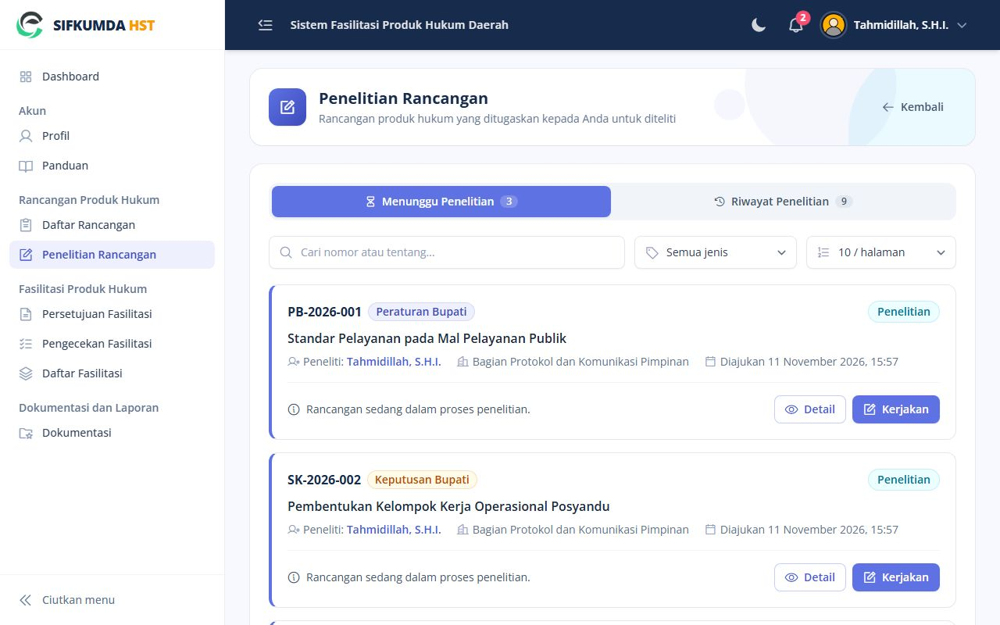
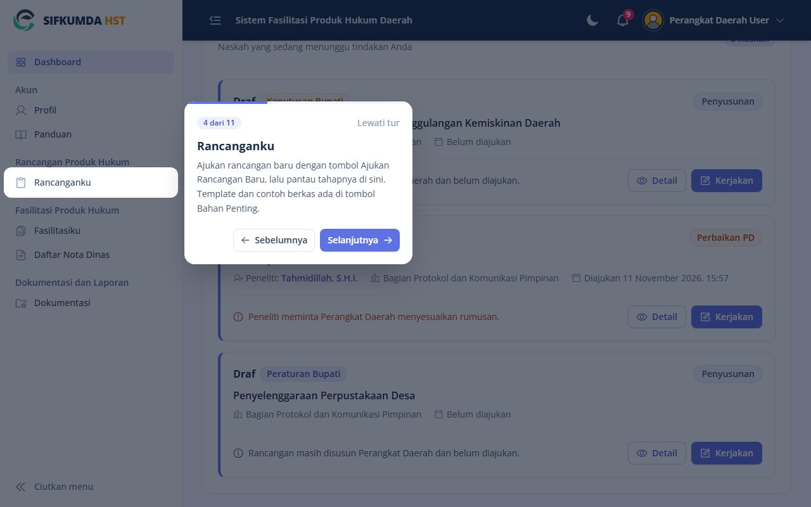
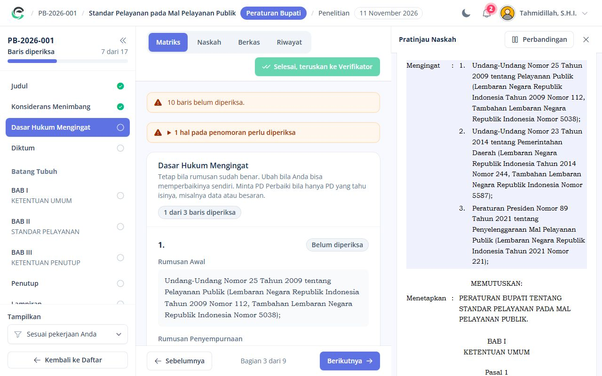

# Panduan Peneliti

Anda meneliti rancangan yang ditugaskan Verifikator, baris demi baris di matriks, lalu memeriksa
naskah yang diajukan untuk fasilitasi.

## Menu Anda

| Menu | Isi |
|---|---|
| Dashboard | Naskah yang menunggu tindakan Anda |
| Penelitian Rancangan | Rancangan yang ditugaskan kepada Anda |
| Persetujuan Fasilitasi | Naskah yang diajukan untuk fasilitasi |
| Pengecekan Fasilitasi | Perbaikan Perangkat Daerah yang perlu Anda cek |
| Daftar Rancangan, Daftar Fasilitasi, Dokumentasi | Untuk dibaca |

*Penelitian Rancangan: rancangan yang ditugaskan kepada Anda*

**Tur pengenalan.** Saat pertama masuk, Dashboard menampilkan tur singkat yang menyorot menu Anda satu
per satu. Tekan **Selanjutnya** untuk lanjut atau **Lewati tur**. Tur bisa diulang dari halaman **Panduan**
(tombol **Ulangi Tur Pengenalan**) atau menu akun di kanan atas (**Tur Pengenalan**).

*Tur pengenalan menyorot menu satu per satu*

## 1. Meneliti rancangan

1. Buka naskah dari **Penelitian Rancangan** (tombol **Kerjakan**).
2. Panel kiri berisi bagian naskah. Untuk setiap baris pilih salah satu:
   - **Tetap**: rumusan sudah benar.
   - **Ubah**: Anda memperbaiki sendiri. Tulis rumusan penyempurnaan dan keterangannya.
   - **Minta PD Perbaiki**: hanya Perangkat Daerah yang tahu isinya (misalnya data atau besaran).
     Tulis apa yang perlu diperbaiki.

   Pada baris **Judul**, tombolnya **Ubah Judul**: judul pengajuan, judul naskah, dan bunyi "Menetapkan"
   diubah bersama dan tercatat sebagai rumusan penyempurnaan.
3. Baris baru bisa ditambahkan dengan **Sisipkan Baris**; rumusan yang tidak perlu bisa dihapus dengan **Hapus Rumusan**.
4. Tanda pada panel kiri menunjukkan bagian yang sudah selesai diperiksa. Daftar **hal perlu diperiksa**
   di atas matriks mengingatkan isian "…" yang tertinggal, judul atau "Menetapkan" yang tidak sama dengan
   judul pengajuan, dan penomoran pasal yang melompat. Tekan butirnya untuk membuka barisnya.
5. Setelah semua baris diperiksa:
   - Bila ada baris untuk PD: **Kirim ke PD**. Naskah kembali kepada Anda setelah PD mengirim tindak lanjut.
     Baris yang diperbaiki PD bertanda **Sudah disesuaikan** dan dihitung belum diperiksa: periksa lalu
     **Terima Perbaikan**, **Ubah** bila masih perlu disempurnakan, atau **Pakai Rumusan Awal** untuk
     membuang perbaikan PD.
   - Bila tidak ada: **Selesai, teruskan ke Verifikator**.

*Matriks penelitian: tiap baris ditetapkan, diubah, atau dimintakan perbaikan ke PD*

**Pratinjau Naskah** di kanan, dan tab **Naskah › Perbandingan**, menunjukkan hasil cetak beserta
perubahan (merah dihapus, hijau ditambah).

## 2. Fasilitasi

- **Persetujuan Fasilitasi**: **naskah hasil perbaikan** disusun otomatis dari matriks (PD tidak mengunggah
  file); tampil di atas matriks dengan tombol **Lihat** dan **Word**. Sebelum mengajukan, PD boleh
  menyempurnakan naskahnya: baris yang diperbaiki, disisipkan, atau diusulkan dihapus PD muncul sebagai
  *belum diperiksa*. Putuskan masing-masing (**Terima Perbaikan**, **Terima Hapus**, **Pakai Rumusan Awal**,
  **Ubah**, atau **Hapus Baris** untuk sisipan), lalu **Berkas fasilitasi lengkap**. Bila masih ada yang
  harus diperbaiki PD, pakai **Minta PD Perbaiki** pada barisnya lalu **Kirim ke PD**; naskah masuk
  **Perbaikan Fasilitasi** dan kembali kepada Anda di **Pengecekan Fasilitasi**.
- **Pengecekan Fasilitasi**: setelah PD memperbaiki permintaan Anda atau Verifikator, periksa lagi lalu
  **Selesai, teruskan ke Verifikator**, atau **Kirim ke PD** bila masih perlu perbaikan.

**Tanda tangan matriks.** Saat menekan **Berkas fasilitasi lengkap** atau **Selesai, teruskan ke
Verifikator**, jendela konfirmasinya memuat bagian **Tanda Tangan Matriks**:

- **Pakai tanda tangan tersimpan**: tanda tangan Anda di Profil.
- **Tanda tangan sekarang**: gambar langsung di kotak (mouse, jari, atau stylus), khusus untuk naskah ini.
  Centang **Simpan juga sebagai tanda tangan saya** bila ingin memakainya lagi.

Tanda tangan ini dicetak di matriks setelah nota dinas terbit. Bila naskah dikembalikan dan Anda memeriksa
ulang, tanda tangan yang baru menggantikan yang lama.

## 3. Tanda tangan Anda

Tanda tangan tersimpan dipakai saat Anda memilih **Pakai tanda tangan tersimpan** di atas. Atur lewat menu
akun di kanan atas › **Profil** › kartu **Tanda Tangan**: **Unggah Gambar** (PNG transparan paling rapi;
JPG berlatar putih juga bisa) atau **Gambar Langsung**, masukkan kata sandi, lalu **Simpan Tanda Tangan**. Bila perlu bantuan, Admin bisa mengunggahkannya di menu **Kelola TTD**.

## Pertanyaan umum

**Tombol kirim tidak bisa ditekan.** Masih ada baris yang belum diperiksa; jumlahnya tertulis di atas matriks.

**Salah menandai baris.** Selama naskah masih giliran Anda, tekan tombol lain pada baris itu untuk menggantinya.
