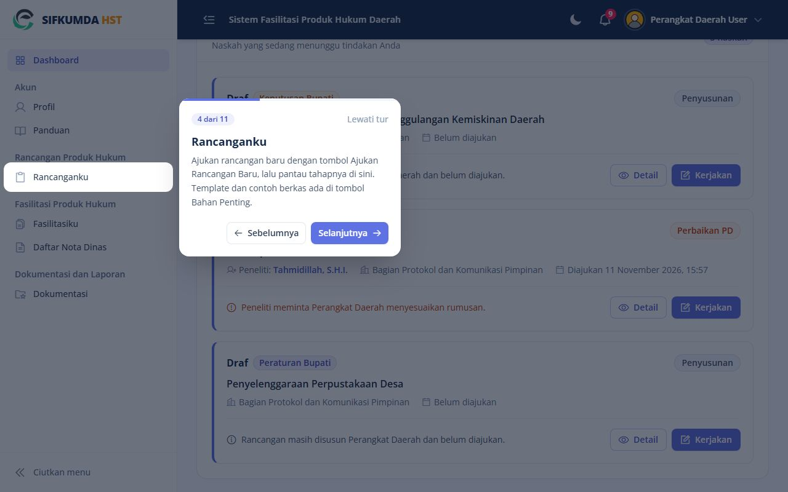
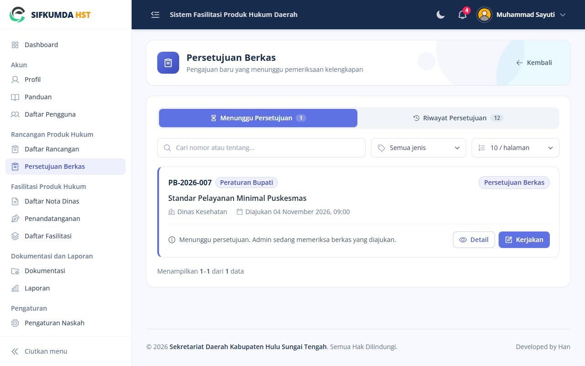
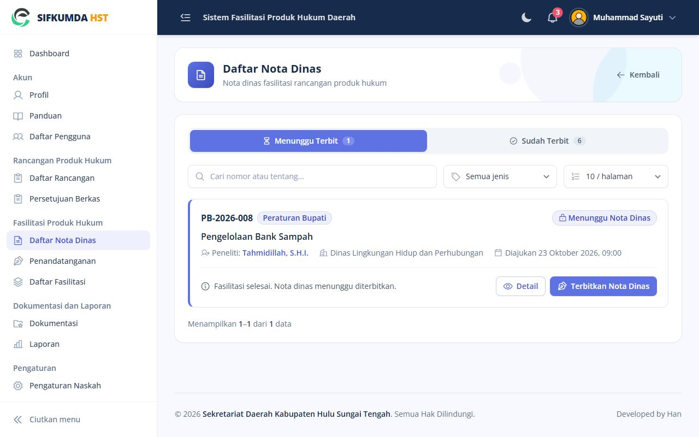
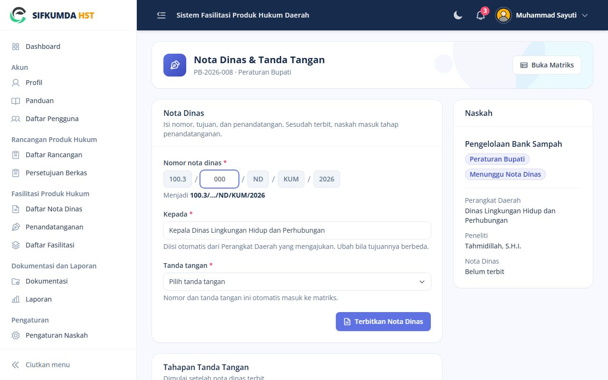
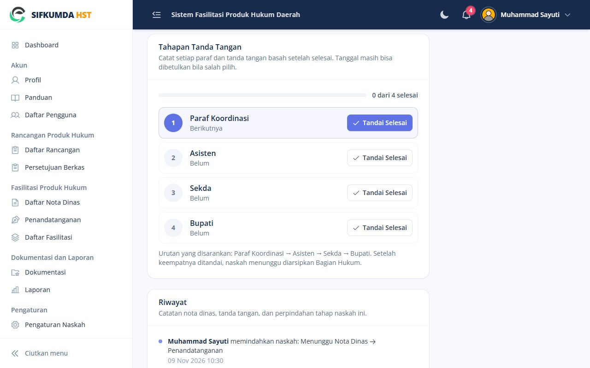
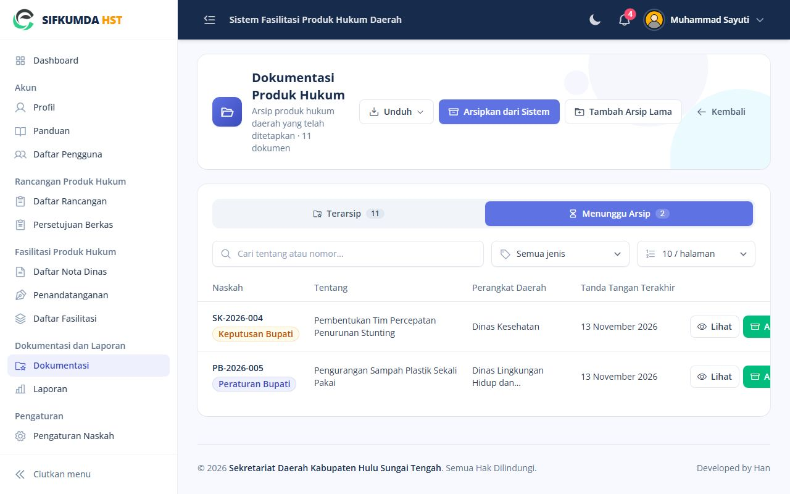
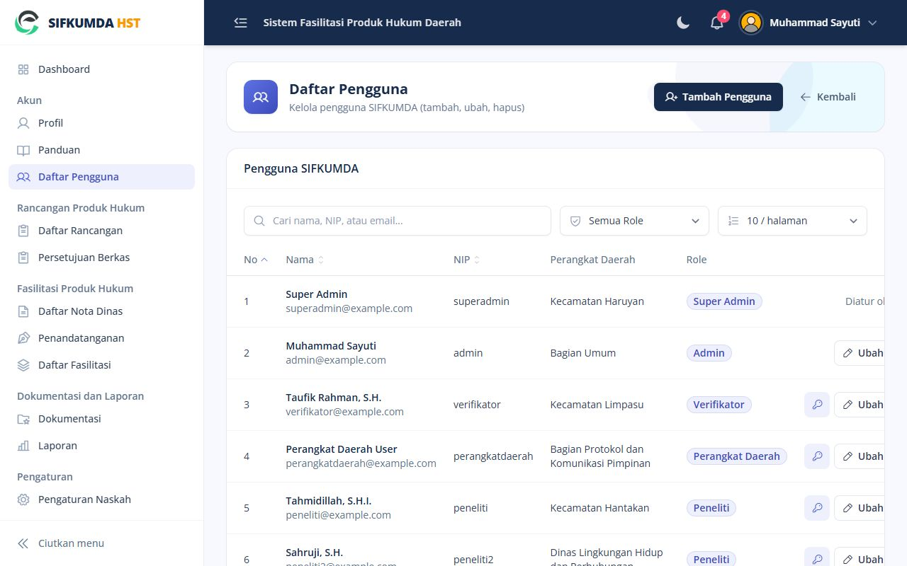
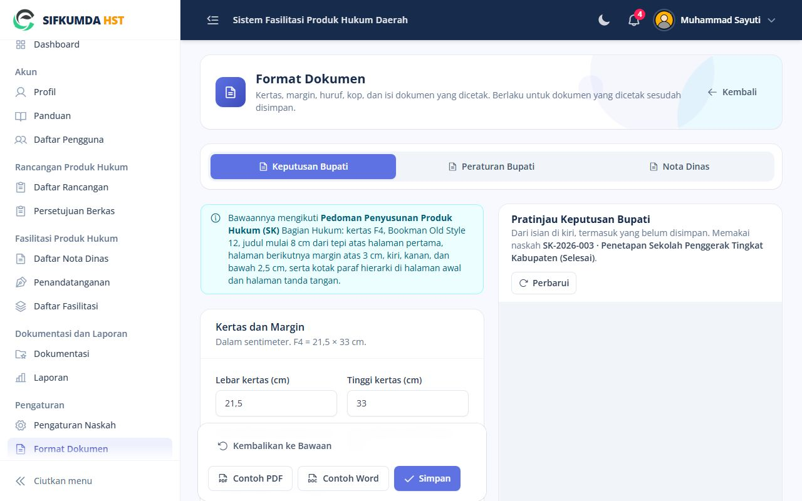

# Panduan Admin

Anda memeriksa kelengkapan berkas pengajuan, menerbitkan nota dinas, mencatat paraf dan tanda tangan,
mengarsipkan produk hukum, serta mengelola pengguna dan pengaturan. Untuk penyelesaian masalah, lihat
juga **Runbook Admin** (`docs/RUNBOOK-ADMIN.md`).

## Menu Anda

| Menu | Isi |
|---|---|
| Persetujuan Berkas | Pengajuan baru yang menunggu pemeriksaan |
| Daftar Rancangan, Daftar Fasilitasi | Semua naskah |
| Daftar Nota Dinas, Penandatanganan | Naskah pada tahap akhir |
| Dokumentasi | Arsip produk hukum; tab Menunggu Arsip |
| Laporan | Rekap naskah per tahap dan per Perangkat Daerah, naskah yang tertahan, unduh Excel |
| Akun › Daftar Pengguna | Akun pengguna |
| Pengaturan | Pengaturan Naskah, Format Dokumen, Template Bahan Penting, Perangkat Daerah |

**Tur pengenalan.** Saat pertama masuk, Dashboard menampilkan tur singkat yang menyorot menu Anda satu
per satu. Tekan **Selanjutnya** untuk lanjut atau **Lewati tur**. Tur bisa diulang dari halaman **Panduan**
(tombol **Ulangi Tur Pengenalan**) atau menu akun di kanan atas (**Tur Pengenalan**).

*Tur pengenalan menyorot menu satu per satu*

## 1. Memeriksa berkas pengajuan

Buka naskah dari **Persetujuan Berkas**. Periksa nota dinas PD di tab **Berkas** dan isi naskah.
- **Berkas lengkap**: diteruskan ke Verifikator untuk ditugaskan peneliti.
- **Lainnya › Kembalikan ke Penyusunan (PD)** dengan alasan.

*Persetujuan Berkas: pengajuan baru dari Perangkat Daerah*

## 2. Menerbitkan nota dinas

Nota dinas bisa diterbitkan oleh **Admin maupun Verifikator**; siapa pun yang lebih dulu boleh
mengerjakannya. Keduanya menerima notifikasi saat ada naskah yang fasilitasinya selesai.

1. Buka **Daftar Nota Dinas**, tab **Menunggu Terbit**, lalu tekan **Terbitkan Nota Dinas** pada naskahnya.

*Daftar Nota Dinas: naskah yang menunggu nota dinas*

2. Isi **nomor urut** saja. Bagian lain nomor (mis. `100.3/…/ND/KUM/2026`) mengikuti pola di
   **Pengaturan › Format Dokumen**.
3. Periksa **Kepada**. Isinya terisi dari Perangkat Daerah yang mengajukan dan bisa diubah bila tujuannya berbeda.
4. Pilih **Tanda tangan** pejabat. Daftar pejabatnya dikelola Verifikator di **Kelola TTD**.
5. Tekan **Terbitkan Nota Dinas**. Nota dinas bisa diunduh, Perangkat Daerah mendapat kabar, dan
   naskah masuk tahap **Penandatanganan**.

*Menerbitkan nota dinas: nomor urut, Kepada, dan tanda tangan*

**Salah pilih penanda tangan atau tujuan**, atau Format Dokumen berubah: tekan **Perbaiki & Terbitkan
Ulang** di halaman yang sama. Nomor dan tanggal tetap; versi lama tersimpan sebagai "Diganti".

**Isi naskah ternyata perlu diubah** setelah dikunci: hanya Verifikator yang bisa mengembalikannya ke
Validasi Fasilitasi.

## 3. Mencatat paraf dan tanda tangan

Buka naskah dari **Penandatanganan** (tombol **Catat Tanda Tangan**).
- Tekan **Tandai Selesai** pada tahapan yang sudah selesai dan pilih tanggalnya.
- Salah tanggal: **Ubah Tanggal**. Salah tandai: **Batalkan**.
- Setelah semua tahapan selesai, naskah masuk ke **Dokumentasi › Menunggu Arsip**.

Urutan tahapan diatur di **Pengaturan › Pengaturan Naskah › Urutan Tanda Tangan**.

*Tahapan Tanda Tangan: tandai tiap tahapan yang sudah selesai*

## 4. Mengarsipkan

Di menu **Dokumentasi** ada dua tombol:

- **Arsipkan dari Sistem**: pilih naskah SIFKUMDA yang paraf dan tanda tangannya lengkap. Jenis, judul,
  dan perangkat daerah terisi dari naskahnya; naskah itu ikut selesai. Sama dengan tombol **Arsipkan**
  di tab **Menunggu Arsip**.
- **Tambah Arsip Lama**: produk hukum yang ditetapkan sebelum ada sistem, semua diisi manual.

Isi nomor, tanggal penetapan, Berita Daerah, dan unggah PDF bertanda tangan basah. Tahun nomor
mengikuti tanggal penetapan. Berita Daerah wajib untuk Peraturan Bupati dan boleh dikosongkan untuk
Keputusan Bupati.

*Dokumentasi: tab Menunggu Arsip dan tombol Arsipkan dari Sistem*

Naskah yang tertahan lama terlihat di menu **Laporan**. Pemegang gilirannya juga mendapat notifikasi
pengingat otomatis setiap 7 hari.

## 5. Pengguna

**Akun › Daftar Pengguna**:
- **Tambah Pengguna**: tautan aktivasi dikirim ke email pengguna.
- Tombol **kunci**: kata sandi sementara bila email tidak bisa dipakai. Tampil sekali; sampaikan langsung.
- **Ubah** untuk mengganti peran atau Perangkat Daerah. Akun yang sudah tercatat pada naskah tidak bisa dihapus.

*Daftar Pengguna*

## 6. Pengaturan

| Menu | Kapan dipakai |
|---|---|
| Pengaturan Naskah | Bupati/Sekda berganti; urutan tanda tangan berubah |
| Format Dokumen | Kop, margin, huruf, paraf hierarki, pola nomor, atau isi nota dinas berubah. Pratinjau di kanan menunjukkan hasilnya sebelum disimpan |
| Template Bahan Penting | Menambah berkas yang bisa diunduh Perangkat Daerah |
| Perangkat Daerah | Instansi baru atau berganti nama |

*Format Dokumen: pengaturan di kiri, pratinjau di kanan*
