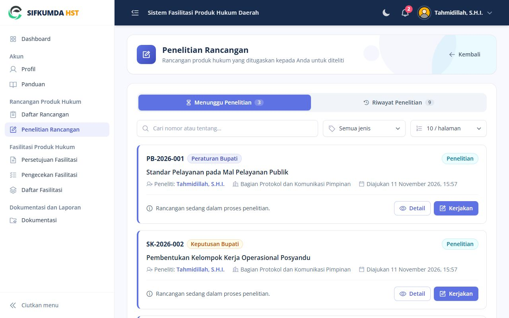
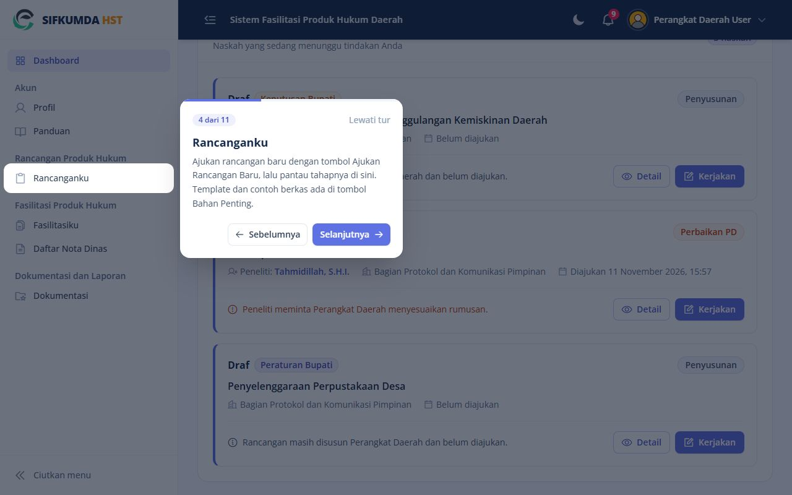
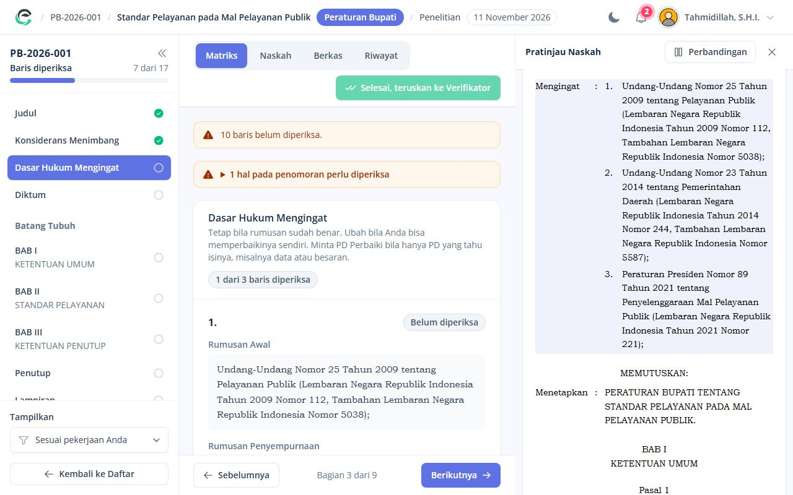

# Panduan Peneliti

Anda meneliti rancangan yang ditugaskan Verifikator, baris demi baris di matriks, lalu memeriksa
naskah yang diajukan untuk fasilitasi.

## Menu Anda

| Menu | Isi |
|---|---|
| Dashboard | Naskah yang menunggu tindakan Anda |
| Penelitian Rancangan | Rancangan yang ditugaskan kepada Anda |
| Persetujuan Fasilitasi | Naskah yang diajukan untuk fasilitasi |
| Pengecekan Fasilitasi | Perbaikan Perangkat Daerah yang perlu Anda cek |
| Daftar Rancangan, Daftar Fasilitasi, Dokumentasi | Untuk dibaca |

*Penelitian Rancangan: rancangan yang ditugaskan kepada Anda*

**Tur pengenalan.** Saat pertama masuk, Dashboard menampilkan tur singkat yang menyorot menu Anda satu
per satu. Tekan **Selanjutnya** untuk lanjut atau **Lewati tur**. Tur bisa diulang dari halaman **Panduan**
(tombol **Ulangi Tur Pengenalan**) atau menu akun di kanan atas (**Tur Pengenalan**).

*Tur pengenalan menyorot menu satu per satu*

## 1. Meneliti rancangan

1. Buka naskah dari **Penelitian Rancangan** (tombol **Kerjakan**).
2. Panel kiri berisi bagian naskah. Untuk setiap baris pilih salah satu:
   - **Tetap**: rumusan sudah benar.
   - **Ubah**: Anda memperbaiki sendiri. Tulis rumusan penyempurnaan dan keterangannya.
   - **Minta PD Perbaiki**: hanya Perangkat Daerah yang tahu isinya (misalnya data atau besaran).
     Tulis apa yang perlu diperbaiki.
3. Baris baru bisa ditambahkan dengan **Sisipkan Baris**; rumusan yang tidak perlu bisa dihapus dengan **Hapus Rumusan**.
4. Tanda pada panel kiri menunjukkan bagian yang sudah selesai diperiksa. Peringatan penomoran
   (misalnya pasal yang melompat) muncul di atas matriks.
5. Setelah semua baris diperiksa:
   - Bila ada baris untuk PD: **Kirim ke PD**. Naskah kembali kepada Anda setelah PD mengirim tindak lanjut.
   - Bila tidak ada: **Selesai, teruskan ke Verifikator**.

*Matriks penelitian: tiap baris ditetapkan, diubah, atau dimintakan perbaikan ke PD*

**Pratinjau Naskah** di kanan, dan tab **Naskah › Perbandingan**, menunjukkan hasil cetak beserta
perubahan (merah dihapus, hijau ditambah).

## 2. Fasilitasi

- **Persetujuan Fasilitasi**: periksa apakah naskah yang diajukan sesuai hasil penelitian, lalu
  **Berkas fasilitasi lengkap**, atau **Kembalikan berkas fasilitasi ke PD** dengan alasan.
- **Pengecekan Fasilitasi**: setelah PD memperbaiki permintaan Verifikator, periksa lagi lalu
  **Selesai, teruskan ke Verifikator**, atau **Kirim ke PD** bila masih perlu perbaikan.

## Pertanyaan umum

**Tombol kirim tidak bisa ditekan.** Masih ada baris yang belum diperiksa; jumlahnya tertulis di atas matriks.

**Salah menandai baris.** Selama naskah masih giliran Anda, tekan tombol lain pada baris itu untuk menggantinya.
