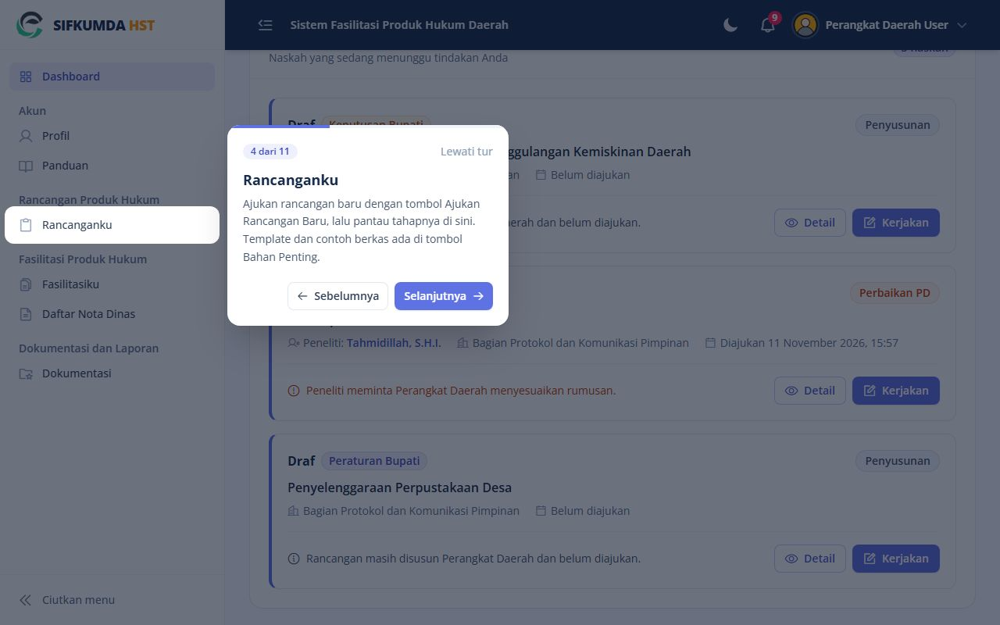
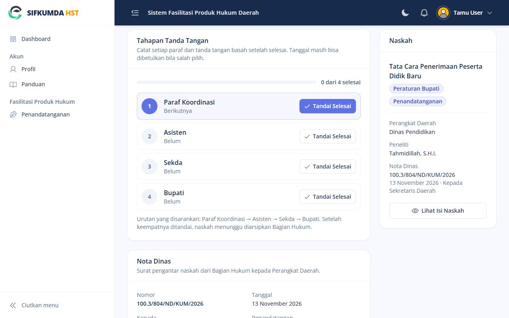

# Panduan Pencatat Tanda Tangan (Tamu)

Akun Tamu dipakai petugas yang mencatat paraf dan tanda tangan basah naskah yang sedang beredar,
misalnya di lingkungan Sekretariat Daerah. Isi naskah hanya bisa dibaca, tidak bisa diubah atau diunduh.

## Menu Anda

| Menu | Isi |
|---|---|
| Dashboard | Naskah yang menunggu dicatat |
| Penandatanganan | Naskah yang sedang dalam proses paraf dan tanda tangan |
| Profil | Akun Anda |

**Tur pengenalan.** Saat pertama masuk, Dashboard menampilkan tur singkat yang menyorot menu Anda satu
per satu. Tekan **Selanjutnya** untuk lanjut atau **Lewati tur**. Tur bisa diulang dari halaman **Panduan**
(tombol **Ulangi Tur Pengenalan**) atau menu akun di kanan atas (**Tur Pengenalan**).

*Tur pengenalan menyorot menu satu per satu*

## Mencatat tahapan

1. Buka **Penandatanganan**, lalu tekan **Pantau** pada naskah.
2. Di kartu **Tahapan Tanda Tangan**, tekan **Tandai Selesai** pada tahapan yang sudah ditandatangani,
   pilih tanggalnya, lalu simpan. Tahapan yang menjadi giliran berikutnya disorot biru.
3. Bila menandai tidak sesuai urutan, sistem mengingatkan; lanjutkan hanya bila memang begitu kejadiannya.

**Salah tanggal**: **Ubah Tanggal**. **Salah tandai**: **Batalkan**.

*Tahapan Tanda Tangan: tahapan berikutnya disorot biru*

Setelah semua tahapan selesai, naskah diserahkan kembali ke Bagian Hukum untuk diarsipkan.

**Membaca isi naskah**: tombol **Lihat Isi Naskah** di kartu Naskah sebelah kanan.
