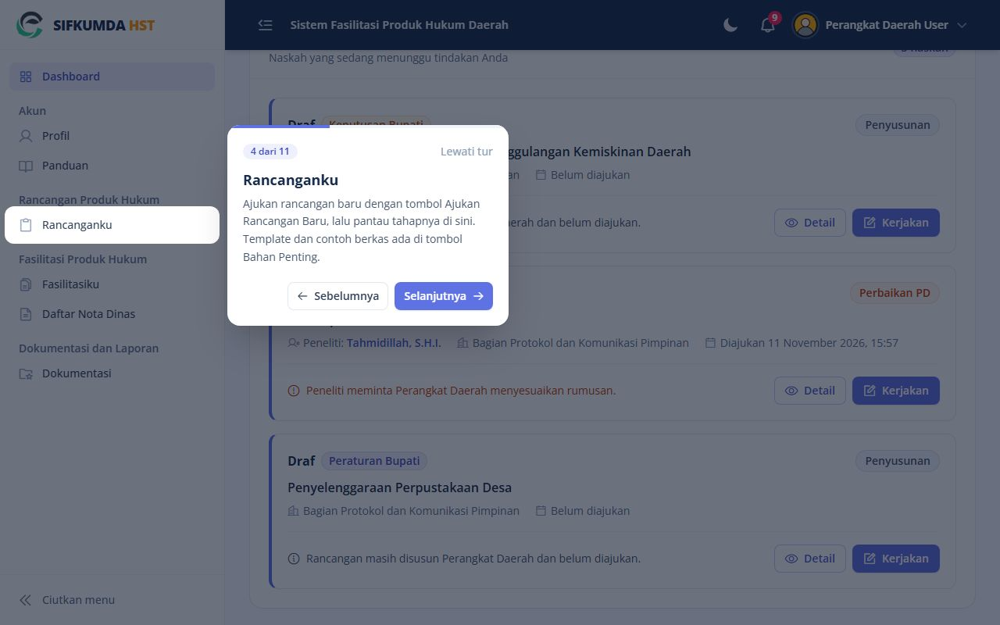
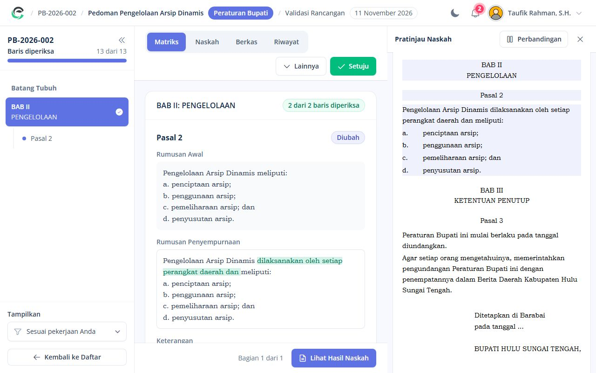
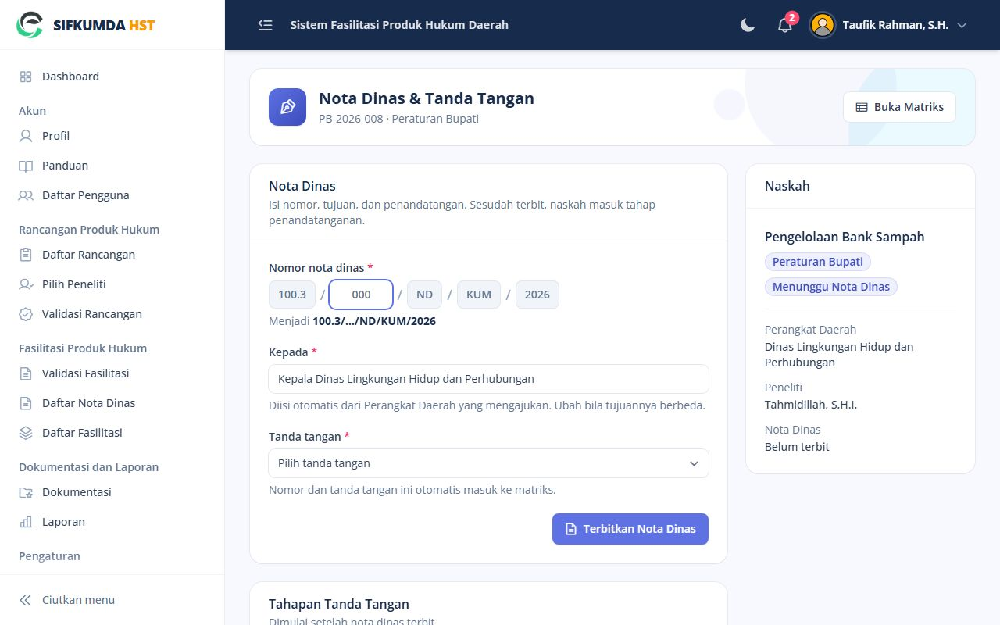
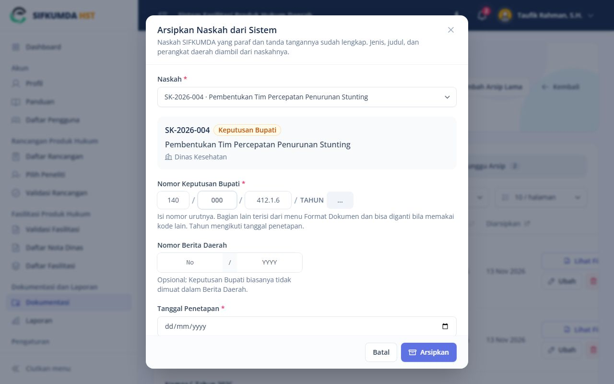
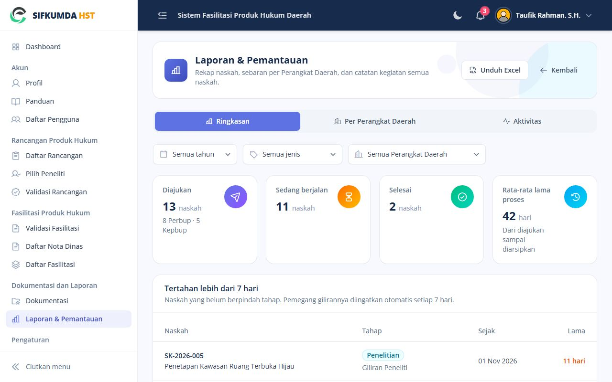
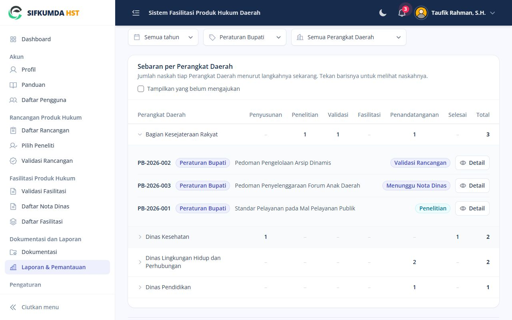
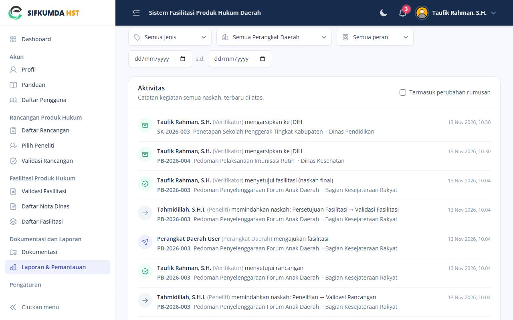

# Panduan Verifikator

Anda menugaskan peneliti, memvalidasi hasil penelitian dan fasilitasi, menerbitkan nota dinas, dan
mengelola pejabat penanda tangan.

## Menu Anda

| Menu | Isi |
|---|---|
| Pilih Peneliti | Rancangan yang menunggu penugasan peneliti |
| Validasi Rancangan | Hasil penelitian yang menunggu validasi |
| Validasi Fasilitasi | Naskah fasilitasi yang menunggu persetujuan |
| Daftar Nota Dinas | Naskah yang menunggu nota dinas dan yang sudah terbit |
| Dokumentasi | Arsip produk hukum; tab **Menunggu Arsip** berisi naskah yang siap diarsipkan |
| Laporan & Pemantauan | Rekap naskah, sebaran per Perangkat Daerah, aktivitas semua naskah, unduh Excel |
| Pengaturan | Pengaturan Naskah, Format Dokumen, Kelola TTD |

**Tur pengenalan.** Saat pertama masuk, Dashboard menampilkan tur singkat yang menyorot menu Anda satu
per satu. Tekan **Selanjutnya** untuk lanjut atau **Lewati tur**. Tur bisa diulang dari halaman **Panduan**
(tombol **Ulangi Tur Pengenalan**) atau menu akun di kanan atas (**Tur Pengenalan**).

*Tur pengenalan menyorot menu satu per satu*

## 1. Menugaskan peneliti

Buka naskah dari **Pilih Peneliti**, tekan **Tugaskan Peneliti**, pilih peneliti, lalu **Lanjutkan**.
Bila nanti perlu diganti: **Lainnya › Ganti Peneliti** di layar kerja.

## 2. Validasi rancangan

Periksa hasil penelitian di matriks (tab **Naskah › Perbandingan** menampilkan perubahannya).
- **Setuju**: rancangan disetujui dan Perangkat Daerah bisa mengajukan fasilitasi.
- **Lainnya › Kembalikan ke Penelitian (Peneliti)** dengan alasan, bila perlu diperbaiki.

*Validasi rancangan di matriks*

## 3. Validasi fasilitasi

Anda bisa membetulkan rumusan langsung di matriks.
- **Setuju**: naskah menjadi final dan isinya **dikunci**. Berikutnya penerbitan nota dinas.
- **Lainnya › Kembalikan ke Perbaikan Fasilitasi (PD)** dengan alasan.

## 4. Menerbitkan nota dinas

Nota dinas bisa diterbitkan oleh **Verifikator maupun Admin**; siapa pun yang lebih dulu boleh
mengerjakannya.

1. Buka naskah dari **Daftar Nota Dinas** (tombol **Terbitkan Nota Dinas**).
2. Isi **nomor urut** saja; bagian lain nomor mengikuti pola di Format Dokumen. **Kepada** terisi dari
   Perangkat Daerah pengaju dan bisa diubah. Pilih **Tanda tangan**.
3. **Terbitkan Nota Dinas**. Naskah masuk tahap Penandatanganan.

*Menerbitkan nota dinas: cukup isi nomor urut, Kepada, dan tanda tangan*

Salah penanda tangan atau tujuan: **Perbaiki & Terbitkan Ulang** di halaman yang sama. Nomor dan
tanggal tetap; versi lama tersimpan sebagai "Diganti".

**Isi naskah ternyata perlu diubah** setelah dikunci: halaman **Nota Dinas & Tanda Tangan › Isi naskah
perlu diubah? › Kembalikan ke Validasi Fasilitasi**. Catatan paraf dan tanda tangan yang sudah ada ikut
terhapus.

## 5. Mengarsipkan

Menu **Dokumentasi › Arsipkan dari Sistem** (atau **Arsipkan** di tab Menunggu Arsip), lalu pilih
naskahnya. Produk hukum lama sebelum ada sistem: **Tambah Arsip Lama**. Isi nomor produk hukum, tanggal penetapan, Berita
Daerah, dan unggah PDF bertanda tangan basah. Untuk Keputusan Bupati nomornya berformat
`[140] / [nomor] / [412.1.6] / TAHUN [tahun]` dan Berita Daerah boleh dikosongkan. Tahunnya mengikuti
tanggal penetapan.

*Arsipkan dari Sistem: data naskah terisi otomatis*

## 6. Laporan & Pemantauan

Menu **Laporan & Pemantauan** punya tiga tab. Filter **jenis** dan **Perangkat Daerah** di atasnya berlaku
untuk ketiganya, dan **Unduh Excel** mengunduh daftar naskah sesuai filter.

- **Ringkasan**: jumlah naskah, rata-rata lama proses, naskah yang tertahan lebih dari 7 hari, dan
  rata-rata lama tiap tahap. Pemegang giliran naskah yang tertahan diingatkan otomatis lewat notifikasi.
- **Per Perangkat Daerah**: siapa mengajukan apa dan sampai mana. Tiap baris satu Perangkat Daerah, tiap
  kolom satu langkah (Penyusunan sampai Selesai). Pilih jenis **Peraturan Bupati** untuk melihat
  Perangkat Daerah mana saja yang mengajukan Perbup. Tekan barisnya untuk melihat naskahnya, lalu
  **Detail**. Centang **Tampilkan yang belum mengajukan** untuk melihat Perangkat Daerah yang belum
  pernah mengajukan.
- **Aktivitas**: catatan kegiatan semua naskah, terbaru di atas, mis. "Taufik Rahman (Verifikator)
  menerbitkan nota dinas". Bisa disaring per peran pelaku dan rentang tanggal. Perubahan rumusan per
  baris disembunyikan supaya ringkas; centang **Termasuk perubahan rumusan** bila perlu.

*Ringkasan: angka utama dan naskah yang tertahan*

*Per Perangkat Daerah: sebaran naskah tiap langkah, baris dibuka untuk melihat naskahnya*

*Aktivitas: siapa melakukan apa pada naskah mana, dan kapan*

## 7. Kelola TTD

Menu **Pengaturan › Kelola TTD**: tambah pejabat penanda tangan nota dinas, unggah gambar tanda tangannya,
dan nonaktifkan yang sudah tidak menjabat.
